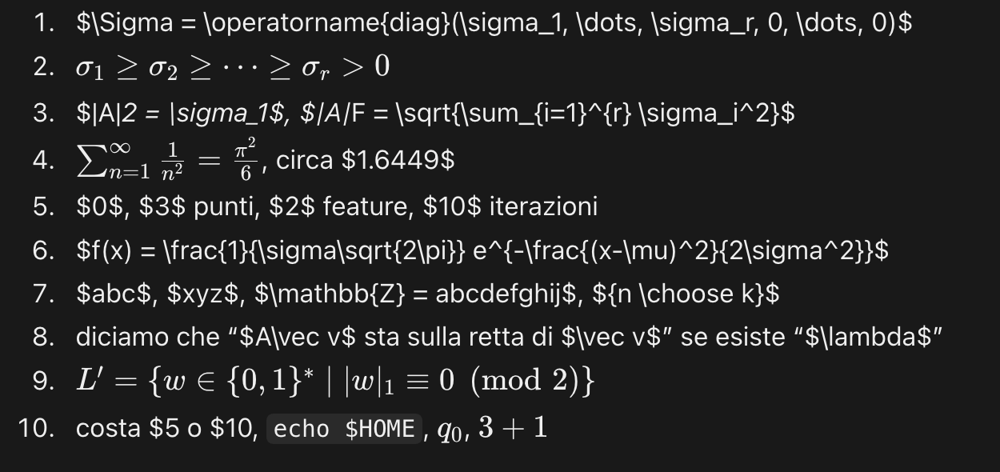
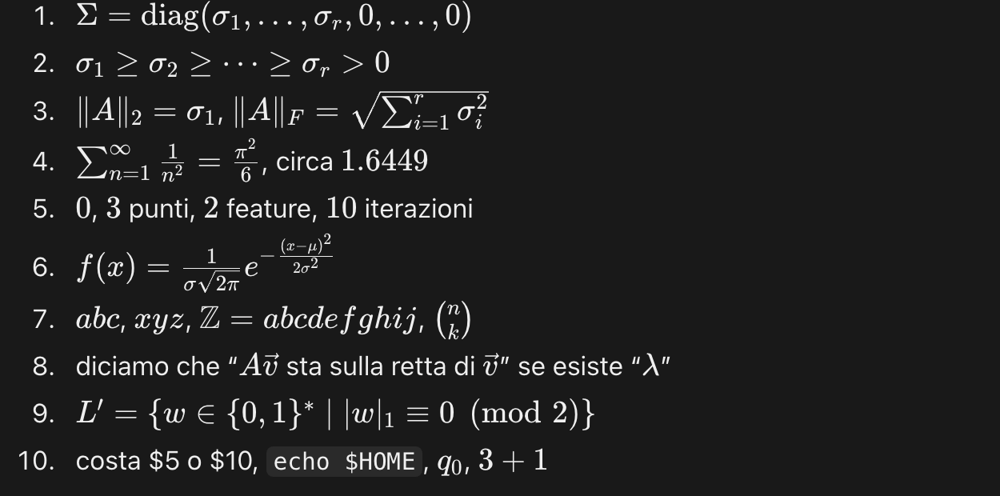

# 🧮 claude-desktop-math-fix

Fixes inline math (`$...$`) showing up as raw text in the Claude desktop app (Code tab).

Bug: [anthropics/claude-code#95866](https://github.com/anthropics/claude-code/issues/95866), [#102139](https://github.com/anthropics/claude-code/issues/102139)

## 🖼️ Before / after

Without the mod:



With the mod:



## 🤔 Why it happens

The app doesn't render every `$...$`. It first guesses whether it's math or just text with dollar signs (like prices). It says "not math" when the formula:

- is **longer than 60 characters**
- is **just a number or a word**: `$3$`, `$abc$`
- has **a word of 4+ letters**: `$\mathbb{Z} = abcde$`
- has **`\|`** in it: `$\|A\|_2$`
- **starts with `{`**: `${n \choose k}$`
- has a **straight quote** right next to it: `"$x$"`

(Plus a few rarer cases: ends with `+` or `=`, contains `@` or `#`, a letter glued to the `$`…)

## 🔧 What the mod does

When Claude writes a formula the app would show as raw text, the mod changes how it's written, so the app accepts it.

| Claude writes | The mod changes it to |
|---|---|
| `$3$` | `$\textstyle 3$` |
| `$abc$` | `$\textstyle abc$` |
| `${n \choose k}$` | `$\textstyle {n \choose k}$` |
| `$\mathbb{Z} = abcde$` | `$\mathbb{Z} = {abcde}$` |
| `$\\|A\\|$` | `$\Vert A\Vert$` |
| `"$x$"` | `“$x$”` |
| a formula over 60 characters | the same formula between `\(` and `\)` |

Formulas that already work, code, and prices like $5 are not changed.

## ⚖️ Trade-off

**Why does the app reject some formulas?**
A `$` in a message is often not math: prices (`$5 and $10`), shell variables (`$HOME`), spreadsheet refs (`$A$1`), templates (`${x}`). Rendering every `$...$` would turn normal text into italic formulas. So the app plays safe and only renders what clearly looks like math. The cost: some real formulas stay raw.

This mod could be useful if you work with a lot of math in Claude.

## 📦 Install

From a shell:

```bash
claude plugin install desktop-math-fix --marketplace teoang/claude-desktop-math-fix
```

Or in the desktop app: **+** → **Plugins** → **Add marketplace** → `teoang/claude-desktop-math-fix` → **Add plugin**.

## 🧹 Disable / Uninstall

Turn it off without removing it:

```bash
claude plugin disable desktop-math-fix@claude-desktop-math-fix
```

Turn it back on:

```bash
claude plugin enable desktop-math-fix@claude-desktop-math-fix
```

Remove it:

```bash
claude plugin uninstall desktop-math-fix@claude-desktop-math-fix
```

To also remove the marketplace:

```bash
claude plugin marketplace remove claude-desktop-math-fix
```

Or in the desktop app: **Plugins** → `desktop-math-fix` → remove it.

New sessions start without the mod.
